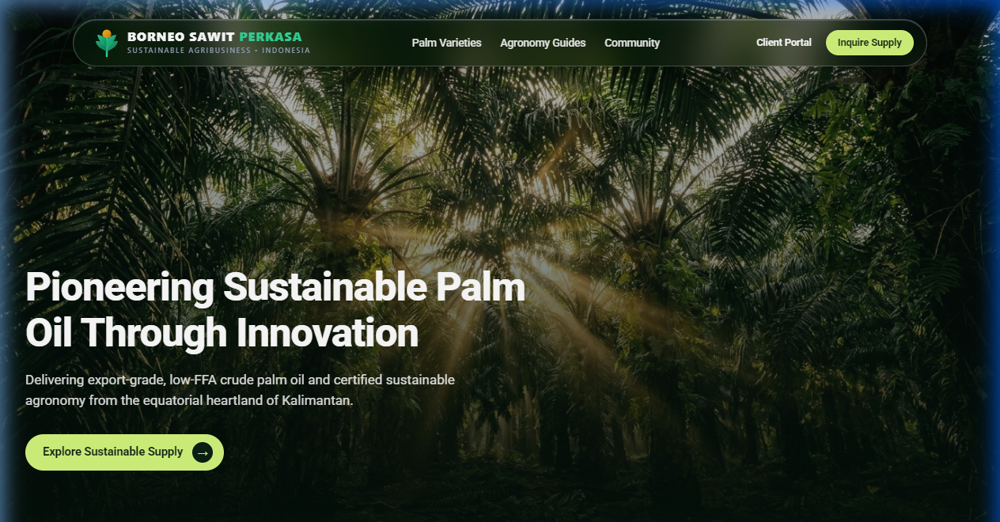
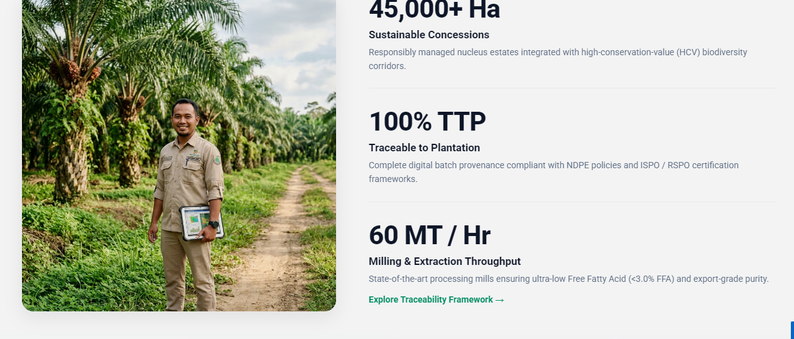
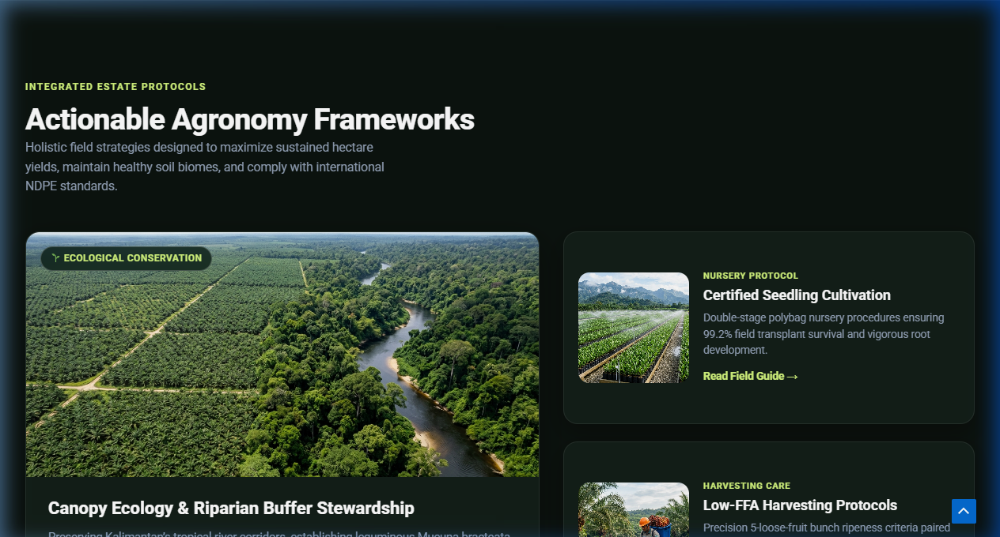
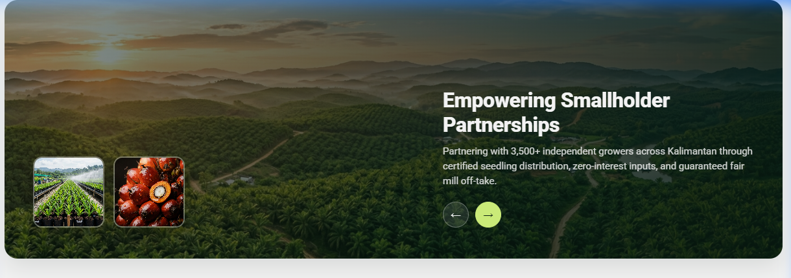

# PT Borneo Sawit Perkasa

## Sustainable Palm Oil & Integrated Agribusiness Landing Page

A corporate landing page designed for PT Borneo Sawit Perkasa, an integrated sustainable palm oil and agro-industrial enterprise operating in Kalimantan, Indonesia. The web application features a modern eco-agronomic design language, asymmetric bento grids, glassmorphism interface components, and full static performance optimization.

**Live Deployment:** [https://wp-barito-sawit.pages.dev/](https://wp-barito-sawit.pages.dev/)

---

## Architecture & Development Workflow

This project bridges visual content management with high-performance static delivery:

- **Visual Authoring & Layout:** Built using WordPress with Elementor and the Astra theme framework. The layout is structured into modular Elementor containers, allowing non-technical teams to visually edit headlines, agronomic metrics, corporate statements, and imagery.
- **Static Export Pipeline:** Pre-rendered and converted from the dynamic WordPress environment into a clean, standalone static distribution. CMS runtime dependencies, admin hooks, and database overhead have been eliminated, resulting in an ultra-fast, secure, and production-ready static site.
- **Styling Architecture:** High-fidelity UI styling is driven by custom scoped design tokens (`bsp-rebuild.css`), providing fluid typography, responsive asymmetric grids, and backdrop glassmorphism while keeping Elementor markup intact.

---

## Interface Overview

### 1. Hero & Navigation Interface
The header incorporates a floating glassmorphic navigation bar with integrated brand identity, quick section anchors, client portal trigger, and immediate call-to-action against a high-resolution equatorial rainforest canopy backdrop.



---

### 2. Operational Concessions & Traceability Metrics
Highlights core operational credentials, plantation concession scale, and sustainability compliance metrics with high-contrast typography and digital field agronomist imagery.



Key highlights:
- **45,000+ Ha Sustainable Concessions:** Responsibly managed nucleus estates integrated with high-conservation-value (HCV) biodiversity corridors.
- **100% Traceability to Plantation (TTP):** Complete batch provenance compliant with NDPE policies and ISPO / RSPO certification frameworks.
- **60 MT / Hour Extraction Throughput:** Processing mills calibrated to ensure ultra-low Free Fatty Acid (<3.0% FFA) export-grade crude palm oil.

---

### 3. Integrated Agronomy Frameworks (Bento Architecture)
Presents field protocols utilizing an asymmetric bento grid layout with contextual tags, high-definition agronomy imagery, and interactive direction indicators.



Framework modules:
- **Canopy Ecology & Riparian Buffer Stewardship:** Preserving Kalimantan tropical river corridors and establishing leguminous cover crops for natural nitrogen fixation and biological pest management.
- **Certified Seedling Cultivation:** Double-stage polybag nursery procedures ensuring 99.2% field transplant survival and vigorous root system development.
- **Low-FFA Harvesting Protocols:** Precision ripeness criteria paired with 24-hour rapid mill transit to guarantee low free fatty acidity.

---

### 4. Smallholder Partnership & Community Outreach
Showcases the community empowerment initiative partnering with local smallholders across Kalimantan, framed in a rounded panoramic card with estate views and agricultural thumbnails.



Program deliverables:
- Partnership with 3,500+ independent growers across Kalimantan.
- Certified seedling distribution and zero-interest agricultural inputs.
- Guaranteed fair mill off-take agreements.

---

## Technology Stack

- **Design & Content Authoring:** WordPress with Elementor (modular container system) and Astra theme.
- **Frontend & Styling:** Semantic HTML5, Vanilla CSS3 with scoped design tokens (`bsp-rebuild.css`), CSS Grid, Flexbox, and backdrop-filter glassmorphism.
- **Typography:** Inter and Outfit font pairings loaded via Google Fonts with display swap optimization.
- **Delivery Format:** Standalone static export (HTML5/CSS3/JS) with zero server-side runtime dependencies.
- **Deployment Compatibility:** Fully compatible with GitHub Pages, Cloudflare Pages, Vercel, Netlify, and standard Apache/Nginx web servers.

---

## Directory Structure

```
.
|-- index.html                       # Pre-rendered static landing page
|-- README.md                        # Project documentation and visual showcase
|-- screenshots/                     # Curated interface previews
|   |-- hero-section.png             # Hero banner and glassmorphic header
|   |-- traceability-metrics.png     # Concession stats and traceability grid
|   |-- agronomy-frameworks.png      # Asymmetric bento agronomy layout
|   +-- smallholder-partnerships.png # Community empowerment banner
|-- wp-content/                      # Extracted static assets, theme styles, and uploads
|   |-- themes/
|   |   +-- astra/
|   |       +-- bsp-rebuild.css      # Core design tokens and custom styles
|   +-- uploads/                     # Optimized photography and visual assets
+-- wp-includes/                     # Core helper scripts and web font utilities
```

---

## Local Setup & Preview

Since this distribution is fully pre-rendered static HTML, it requires no database, PHP, or backend runtime. Any standard local HTTP server can be used to serve the files:

### Using Python 3
```bash
python -m http.server 8080
```

### Using Node.js (npx serve)
```bash
npx serve .
```

### Using PHP Built-in Server
```bash
php -S localhost:8080
```

Once running, navigate to `http://localhost:8080` in your browser.

---

## Production Deployment

### Cloudflare Pages (Active Deployment)
- **Production URL:** [https://wp-barito-sawit.pages.dev/](https://wp-barito-sawit.pages.dev/)
- **Build Settings:** Framework preset `None`, build command empty, output directory `/`. Continuous deployment is active via the `main` branch.

### GitHub Pages
1. Push the contents of this folder directly to your GitHub repository (e.g., `main` branch).
2. Go to repository **Settings** > **Pages**.
3. Under **Build and deployment**, select **Source** as `Deploy from a branch`.
4. Choose the `main` branch and root (`/`) folder, then click **Save**.

### Vercel / Netlify
1. Connect your repository to the hosting platform.
2. Set the build command to empty (no build step required).
3. Set the output directory to root (`.`).
4. Deploy.

---

## License & Intellectual Property

Proprietary corporate design and landing page developed for PT Borneo Sawit Perkasa. All rights reserved.
